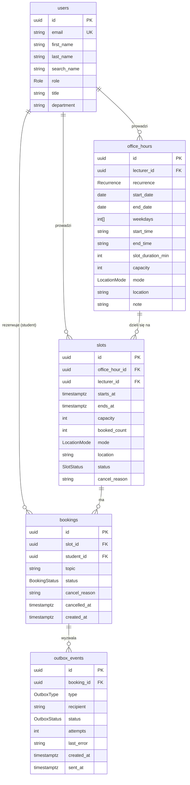

# Baza danych

Schemat opisuje Prisma w [`backend/prisma/schema.prisma`](../backend/prisma/schema.prisma).
Pełny opis modelu i reguł biznesowych: `plan.md` sekcje 2.2 i 2.1.A. Ten dokument pokazuje,
jak tabele łączą się ze sobą i jak ręcznie sprawdzić dwie reguły spójności dodane osobną migracją SQL.

## Diagram ERD



## Tabele

- **users** — wszyscy użytkownicy (STUDENT, LECTURER, ADMIN). Konta pochodzą z seeda, nie ma rejestracji.
  Kolumna `search_name` to nazwisko i imię zapisane małymi literami i bez polskich znaków (np. `lukasiewicz ewa`),
  dzięki czemu wyszukiwarka działa też dla wpisania „lukasiewicz”. Wartość liczy funkcja `normalizeSearchName`
  (patrz [`backend/src/common/search-name.js`](../backend/src/common/search-name.js)).

- **office_hours** — definicja dyżuru prowadzącego: jednorazowy (`ONCE`) albo cotygodniowy (`WEEKLY`) w zakresie dat.
  Godziny (`start_time`, `end_time`) trzymamy jako tekst `"14:00"` w czasie polskim; z nich i z `slot_duration_min`
  generator tworzy konkretne sloty. `mode` decyduje, czy `location` to sala, czy link do spotkania w Teams.

- **slots** — pojedynczy termin do rezerwacji wygenerowany z dyżuru. `starts_at` / `ends_at` to czas w UTC.
  `capacity` jest stałe, a liczbę zapisanych trzymamy w `booked_count`. `lecturer_id` to kopia z dyżuru
  (upraszcza zapytania). Usunięcie dyżuru kasuje jego sloty (`onDelete: Cascade`). Odwołany slot zostaje
  w bazie ze statusem `CANCELLED` (historia + e-mail z odwołaniem).

- **bookings** — rezerwacja studenta na slot, z wymaganym `topic` (3–300 znaków). Rezerwacji nigdy nie usuwamy —
  zmienia się tylko `status` (`CONFIRMED` → `CANCELLED_BY_STUDENT` albo `CANCELLED_BY_LECTURER`).

- **outbox_events** — kolejka e-maili. W tej samej transakcji co rezerwacja/odwołanie powstaje wiersz `PENDING`;
  worker wysyła go w tle i ustawia `SENT`, a po 3 nieudanych próbach `FAILED`. Dzięki temu e-mail nigdy nie wychodzi
  w trakcie żądania HTTP i nie ginie, gdy serwer poczty nie działa.

## Dwie reguły spójności (osobna migracja SQL)

Prisma nie potrafi zapisać tych reguł w `schema.prisma`, więc są w ręcznej migracji
[`prisma/migrations/.../constraints/migration.sql`](../backend/prisma/migrations):

1. **`chk_slots_booked_count`** — `CHECK (booked_count >= 0 AND booked_count <= capacity)`.
   To ostatnia linia obrony przed overbookingiem: nawet gdyby kod się pomylił, baza odrzuci zapis,
   który przekroczyłby pojemność slotu.

2. **`uq_bookings_active`** — częściowy indeks unikalny `(slot_id, student_id) WHERE status = 'CONFIRMED'`.
   Pilnuje, żeby student miał najwyżej jedną **aktywną** rezerwację na dany slot. Indeks jest **częściowy**
   (`WHERE status = 'CONFIRMED'`) celowo: gdyby był zwykłym `UNIQUE(slot_id, student_id)`, student, który
   odwołał rezerwację, nie mógłby już nigdy zapisać się na ten sam slot. Przy warunku na status odwołane
   rezerwacje nie blokują ponownego zapisu.

## Jak sprawdzić, że reguły działają (ręcznie, w psql)

Wejdź do bazy w kontenerze:

```powershell
docker compose exec postgres psql -U postgres -d konsultacje
```

### Reguła 1: baza odrzuca `booked_count > capacity`

```sql
-- próba wstawienia slotu z 5 zapisanymi przy pojemności 3 — powinna się NIE udać
INSERT INTO slots (id, office_hour_id, lecturer_id, starts_at, ends_at, capacity, booked_count, mode, location, status)
VALUES (gen_random_uuid(), gen_random_uuid(), gen_random_uuid(), now(), now(), 3, 5, 'IN_PERSON', 'Sala 1', 'OPEN');
-- Oczekiwany efekt: ERROR ... violates check constraint "chk_slots_booked_count"
```

### Reguła 2: student nie może mieć dwóch aktywnych rezerwacji na ten sam slot

```sql
-- przygotuj minimalny komplet danych
INSERT INTO users (id, email, first_name, last_name, search_name, role)
VALUES ('11111111-1111-1111-1111-111111111111', 's@test.local', 'Jan', 'Kowalski', 'kowalski jan', 'STUDENT');
INSERT INTO office_hours (id, lecturer_id, recurrence, start_date, end_date, weekdays, start_time, end_time, slot_duration_min, capacity, mode, location)
VALUES ('22222222-2222-2222-2222-222222222222', '11111111-1111-1111-1111-111111111111', 'ONCE', current_date, current_date, '{}', '14:00', '15:00', 15, 2, 'IN_PERSON', 'Sala 1');
INSERT INTO slots (id, office_hour_id, lecturer_id, starts_at, ends_at, capacity, booked_count, mode, location, status)
VALUES ('33333333-3333-3333-3333-333333333333', '22222222-2222-2222-2222-222222222222', '11111111-1111-1111-1111-111111111111', now(), now(), 2, 0, 'IN_PERSON', 'Sala 1', 'OPEN');

-- pierwsza aktywna rezerwacja — OK
INSERT INTO bookings (id, slot_id, student_id, topic, status)
VALUES (gen_random_uuid(), '33333333-3333-3333-3333-333333333333', '11111111-1111-1111-1111-111111111111', 'Pytanie 1', 'CONFIRMED');

-- druga aktywna rezerwacja tego samego studenta na ten sam slot — powinna się NIE udać
INSERT INTO bookings (id, slot_id, student_id, topic, status)
VALUES (gen_random_uuid(), '33333333-3333-3333-3333-333333333333', '11111111-1111-1111-1111-111111111111', 'Pytanie 2', 'CONFIRMED');
-- Oczekiwany efekt: ERROR ... duplicate key value violates unique constraint "uq_bookings_active"

-- ale po odwołaniu pierwszej rezerwacja ponowna już przechodzi:
UPDATE bookings SET status = 'CANCELLED_BY_STUDENT' WHERE slot_id = '33333333-3333-3333-3333-333333333333';
INSERT INTO bookings (id, slot_id, student_id, topic, status)
VALUES (gen_random_uuid(), '33333333-3333-3333-3333-333333333333', '11111111-1111-1111-1111-111111111111', 'Pytanie 3', 'CONFIRMED');
-- Oczekiwany efekt: INSERT 0 1 (sukces)
```

> Po eksperymentach możesz odtworzyć czystą bazę: `cd backend && npx prisma migrate reset`.
